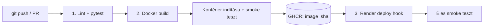

# 🍞 Kovászdada

Kovászgondozó és sütéstervező mini alkalmazás, teljes CI/CD pipeline-nal (GitHub Actions → GHCR → Render).

## Üzleti funkciók

- **Kovászok kezelése** – több kovász névvel és liszttípussal
- **Etetésnapló** – anyakovász : liszt : víz arány, hőmérséklet, időpont
- **Csúcsidő-becslés és állapot** – ébredezik → emelkedik → csúcson → esik → éhes
- **Sütéstervező** – mikor etess, hogy a dagasztásra csúcson legyen
- **Arány-javaslat** – adott idő és hőmérséklet mellett milyen arányban etess

A fermentációs modell (`app/fermentation.py`): 1:1:1 etetés 24 °C-on ≈ 6 óra; minden 8 °C hűlés duplázza az időt; nagyobb hígítás logaritmikusan, alacsonyabb hidratáció enyhén lassít.

## API

| Metódus | Végpont | Leírás |
|---|---|---|
| GET | `/` | Webes felület |
| GET | `/api/health` | Állapot + verzió (commit SHA) |
| GET / POST | `/api/starters` | Kovászok listája / új kovász |
| GET | `/api/starters/{id}` | Kovász részletei etetésekkel |
| POST | `/api/starters/{id}/feedings` | Etetés rögzítése |
| GET | `/api/starters/{id}/status` | Aktuális állapot, csúcsidő |
| POST | `/api/plan` | Sütéstervező |
| GET | `/api/suggest-ratio?hours=&temp_c=` | Arány-javaslat |

Interaktív dokumentáció: `/docs`.

## CI/CD pipeline



| Fázis | Mit csinál | Mikor fut |
|---|---|---|
| 1. Lint + tesztek | `ruff`, `pytest` lefedettséggel, riport artifact | minden push és PR |
| 2. Build | Docker image build, konténer indítása a runneren, smoke teszt, push a GHCR-be | push és PR (PR-nál push nélkül) |
| 3. Deploy | Render deploy hook a commit SHA-val címkézett image-dzsel, majd éles smoke teszt | csak push a `main` ágra |

A telepített artifact a `ghcr.io/<owner>/kovaszdada-pipeline:<commit-sha>` Docker image. Az éles smoke teszt addig vár, amíg a `/api/health` a friss commit SHA-ját nem adja vissza. Ezután végigpróbálja az üzleti funkciókat (kovász létrehozása, etetés, állapot, arány-javaslat).

## Definition of Done igazolása

- Az Actions fülön a három job zöld.
- A `production` environment linkjén az app elérhető, a lábléc a commit rövid SHA-ját mutatja.
- Az éles smoke teszt logja mutatja, hogy az üzleti végpontok működnek.

## Helyi futtatás

```bash
python -m venv .venv && source .venv/bin/activate
pip install -r requirements.txt -r requirements-dev.txt
pytest --cov=app
uvicorn app.main:app --reload
```

Docker:

```bash
docker build --build-arg APP_VERSION=local -t kovaszdada .
docker run -p 8000:8000 kovaszdada
```

## Beállítás (egyszeri)

1. Az első pipeline-futás után a GHCR package legyen **Public**.
2. Render → New Web Service → Existing Image → `ghcr.io/<owner>/kovaszdada-pipeline:latest`, Free plan.
3. GitHub repo → Settings → Secrets and variables → Actions:
   - secret: `RENDER_DEPLOY_HOOK`
   - variable: `RENDER_APP_URL`

## Megjegyzések

- Az adatok memóriában vannak, ezért minden újraindításkor kiürülnek. Indításkor két demo kovász jön létre (`SEED_DEMO=false` kikapcsolja).
- A Render ingyenes példánya 15 perc tétlenség után elalszik, így az első kérés kb. egy percig is eltarthat.

## Projektstruktúra

```text
app/
  fermentation.py   # üzleti logika (tiszta függvények)
  main.py           # FastAPI végpontok
  models.py         # kérés-sémák
  store.py          # memóriabeli tároló
  static/index.html # webes felület
tests/              # unit + API tesztek
scripts/smoke_test.sh
Dockerfile
.github/workflows/ci-cd.yml
```